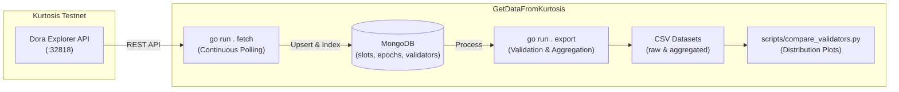

# GetDataFromKurtosis

A data collection and evaluation pipeline for Ethereum Proof-of-Stake (PoS) private devnets deployed via Kurtosis. It queries the Dora Explorer API, persists consensus data in MongoDB, exports standardized datasets, and analyzes block proposer distributions across different PoS weighting mechanisms.

This project supports empirical validation for the **DESW** research paper, comparing:
- **`baseline` (DF)**: Default Ethereum / Lighthouse proposer selection.
- **`srsw`**: Square Root Stake Weighting.
- **`lsw`**: Logarithmic Stake Weighting.
- **`desw`**: Dynamic Exponential Stake Weighting.

---

## 🌟 Key Features

- **Automated Ingestion**: Polls Dora Explorer REST endpoints to continuously record Epochs, Validators, Slots, and canonical Proposers.
- **Pagination Gap Recovery**: Detects and recovers skipped slots caused by Dora's `limit+1` pagination behavior, ensuring zero missing canonical slots.
- **Reliable Storage**: Persists raw network states in MongoDB with automated indexing to guard against data loss across testnet restarts.
- **Integrity Validation**: Verifies contiguous, complete epochs (`ComparableEpochs`) starting from epoch 0 before exporting to CSV.
- **Multi-Model Comparison**: Includes Python visualization scripts to benchmark proposer selection frequencies against validator stake across all models.

---

## 🏗️ Architecture & Workflow



---

## ⚡ Quick Start

### Prerequisites
- Go 1.20+
- MongoDB (local instance or remote connection)
- Python 3.8+ with `matplotlib` (for comparative analysis)
- An active Kurtosis Ethereum devnet with Dora Explorer

### 1. Configuration

Configuration is managed via [`config/config.yaml`](config/config.yaml) or environment variables:

```yaml
mongo:
  mongoURI: "mongodb://127.0.0.1:27017"
  dbName: "kurtosis_desw"

dora:
  url: "http://127.0.0.1:32818"

model: "desw"          # baseline, srsw, lsw, or desw
slots_per_epoch: 32    # Mainnet preset
target_epochs: 200     # Number of contiguous full epochs to collect
output_dir: "output"
time_loop: 10          # Polling interval (seconds)
```

> **Security Note**: Never commit sensitive database credentials. Use the `MONGO_URI` environment variable for authenticated setups:
> ```bash
> export MONGO_URI="mongodb+srv://<user>:<password>@cluster.mongodb.net"
> ```

### 2. Collect Data (`fetch`)

Start the ingestion process for a specific consensus model:

```bash
# Using Makefile (supports CLI parameter overrides)
make fetch MODEL=desw DORA_URL=http://127.0.0.1:32818 TARGET_EPOCHS=200

# Or using Go directly
MODEL=desw go run . fetch
```

The process stops automatically once `target_epochs` contiguous full epochs have been collected.

### 3. Export Datasets (`export`)

Export the verified data from MongoDB into structured CSV and metadata files:

```bash
make export
# Or: go run . export
```

**Output Files** in `output/`:
- `proposers_raw.csv`: Slot-by-slot proposer assignments.
- `proposers_aggregated.csv`: Aggregated proposal counts matched with validator effective balance.
- `run_status.json`: Execution metadata, contiguous epoch count, and verification status.

### 4. Benchmark & Visualize

Compare proposer distributions across all four models (`baseline`, `srsw`, `lsw`, `desw`):

```bash
python scripts/compare_validators.py --input output/ --epochs 200
```

---

## 📁 Project Structure

```
GetDataFromKurtosis/
├── main.go                     # Application entry point (fetch & export CLI)
├── Makefile                    # Task shortcuts
├── config/
│   ├── config.yaml             # Active configuration
│   ├── config.example.yaml     # Sanitized configuration template
│   ├── config.go               # Configuration parser & env overrides
│   └── config_test.go          # Config unit tests
├── model/                      # BSON/JSON data structures (Epoch, Slot, Validator)
├── service/                    # Business logic
│   ├── run.go                  # Main ingestion loop & progress reporting
│   ├── slot.go                 # Slot sync & pagination recovery
│   ├── epoch.go                # Epoch sync service
│   ├── validators.go           # Validator snapshot sync
│   ├── mongodb.go              # Database connection & indexing
│   └── export.go               # Aggregation & CSV exporter
└── scripts/
    └── compare_validators.py   # Multi-model proposer distribution visualizer
```
